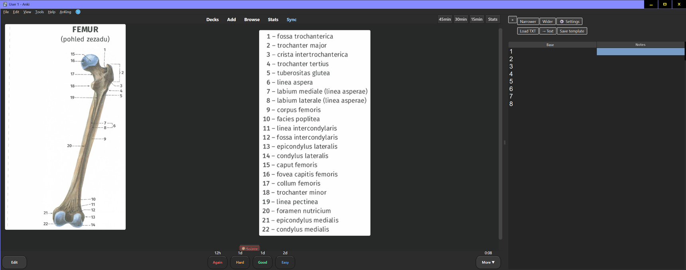

# Deep Notes

Scratchpad panel for the Anki reviewer. Write your answer before you flip the card; it clears after you rate it.

## Features

- Text or table mode (`Alt+M`)
- Table asks **Rows?** per card: number + Enter → numbered rows
- TXT templates per tag / deck (`user_files/templates`)
- **Auto rows** (`Alt+K`): rows from the card's legend (1a, 1b, 2' … each on its own row), points you don't need get `-` (reads `NIE: …` from a notes field)
- **Check** (`Alt+J`): Enter / space at the end checks your answer – green = next row, red = stay; `?` / `idk` / `neviem` shows the answer in blue; abbreviation dictionary (`tbc`, `lig`, `proc` …)
- Remembers card zoom after restart
- Adjustable width, collapse, settings window
- Keyboard-safe: typing never flips the card, `Esc` = back to card
- Local only, no cloud

## Shortcuts

| Key | Action |
|---|---|
| `Alt+M` | text / table |
| `Alt+P` | jump into panel |
| `Alt+N` | collapse |
| `Alt+.` / `Alt+,` | wider / narrower |
| `Alt+I` | load TXT |
| `Alt+W` | save template |
| `Alt+K` | auto rows on / off |
| `Alt+J` | check on / off |
| `Alt+S` | settings |

## Install

Tools → Add-ons → Install from file → `deep_notes.ankiaddon` (Anki 23+, Qt6).

Build: `python build.py` · Options: [config.md](config.md)
